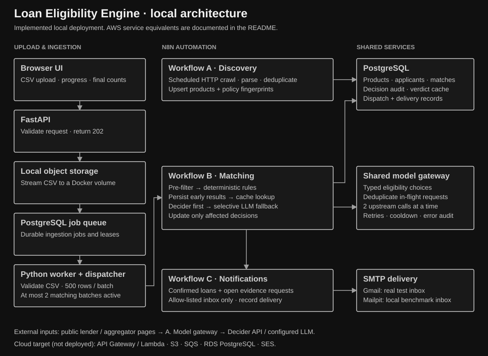
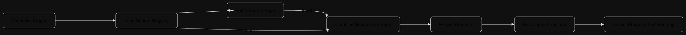
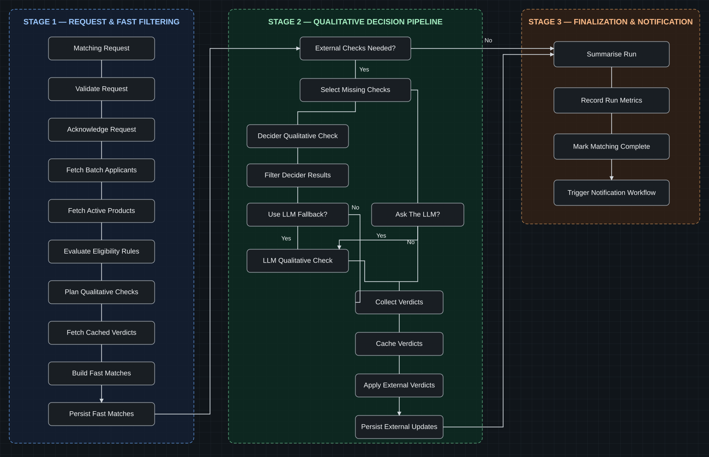
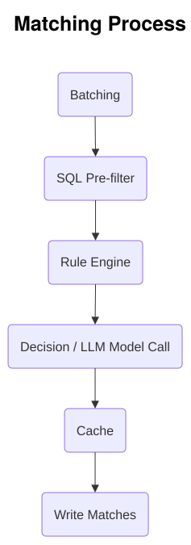
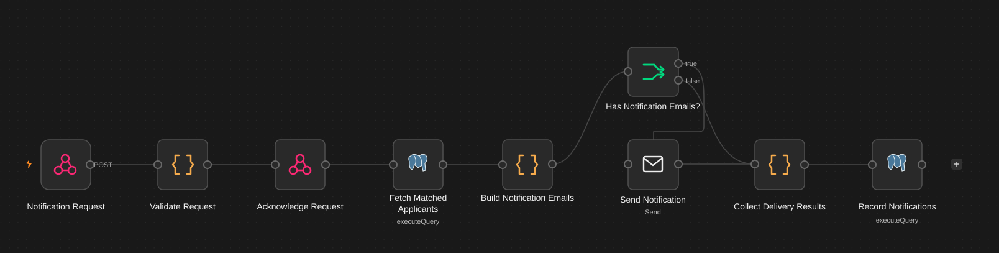
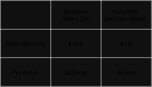

# Loan Eligibility Engine

A local, end-to-end loan eligibility pipeline built with Python, PostgreSQL, self-hosted n8n, and a small upload UI. Upload applicants as CSV, discover published loan policies, evaluate applicant–product pairs, and send personalized results to an allow-listed test inbox.

Real inbox delivery uses **Gmail SMTP**. **Mailpit is an optional local SMTP capture inbox used for bulk tests**, not the real-delivery path.

The implementation runs through Docker Compose. AWS deployment was attempted but blocked by an organization Service Control Policy (SCP); the local deployment and cloud service alternatives are documented below. The assignment explicitly permits local deployment.

## Architecture



The diagram separates the implemented local services from the intended AWS target. It uses native SVG text and a bounded viewport so it stays readable in a README; open any diagram directly to zoom.

| Responsibility | Implemented locally | AWS equivalent / deployment target |
|---|---|---|
| Upload endpoint | FastAPI + browser UI | Presigned-upload API using Lambda, optionally API Gateway |
| Uploaded CSV objects | Streamed files in a Docker volume | S3; an S3 storage adapter exists |
| Ingestion queue | PostgreSQL jobs with leases and retries | SQS; an SQS adapter exists |
| CSV ingestion | Python background worker | Lambda consumer or a container worker |
| Application database | PostgreSQL 17 container | RDS for PostgreSQL |
| Workflow orchestration | Self-hosted n8n container | The same n8n deployment on a managed host / EC2 |
| Discovery schedule | n8n Schedule Trigger | Keep n8n scheduling, or an EventBridge-triggered integration |
| Email | Gmail SMTP; Mailpit for local tests | SES, with verified identities and appropriate sending access |

The adapters do not constitute a deployed AWS stack. Lambda handlers, SES-node deployment, and a `serverless.yml` are **not included in the current repository**.

### Why AWS was not deployed

Creating the test bucket failed with the following AWS CLI error:

```text
aws: [ERROR]: An error occurred (AccessDenied) when calling the CreateBucket operation:
User: arn:aws:sts::438061061757:assumed-role/AccountFullAccessRole/84787468-0001-702a-1558-e227d4621229
is not authorized to perform: s3:CreateBucket on resource:
"arn:aws:s3:::loan-assignment-test-438061061757"
with an explicit deny in a service control policy:
arn:aws:organizations::385579115411:policy/o-nux32beh9r/service_control_policy/p-oy1qid2z
```

The explicit organization-level deny prevented bucket creation despite the assumed role's name. The working demonstration therefore uses local storage, a PostgreSQL queue, PostgreSQL in Docker, and SMTP. No AWS deployment or AWS benchmark is claimed.

To deploy the cloud equivalent later: have the organization administrator review the deny or provide an authorized account; add the missing infrastructure/handlers; provision S3, SQS, RDS and the ingestion consumer; configure network access from n8n to RDS; and configure SES identities and test recipients. Then validate upload events, retries, matching, and received mail in that environment. These are remaining deployment steps, not commands already verified here.

## Run locally

### 1. Configure the environment

Prerequisites: Docker with Compose, Python 3.11+ for helper scripts, and Node.js for JavaScript tests. Docker supplies the application runtime.

```bash
cp .env.example .env
```

Set a strong `POSTGRES_PASSWORD`. Add these settings to `.env`, using your own values:

```dotenv
N8N_API_URL=http://127.0.0.1:5678
N8N_OWNER_EMAIL=your-owner@example.com
N8N_OWNER_PASSWORD=your-strong-owner-password
RELAY_SHARED_SECRET=replace-with-a-long-random-value

OLLAMA_BASE_URL=https://ollama.com
OLLAMA_MODEL=gemma4:31b
OLLAMA_API_KEY=your-provider-key

INGESTION_STORAGE=local
INGESTION_TRIGGER_MATCHING=true
INGESTION_CHUNK_ROWS=500
MATCHING_MAX_CONCURRENCY=2

SMTP_HOST=smtp.gmail.com
SMTP_PORT=465
SMTP_SECURE=true
SMTP_USER=your-sender@gmail.com
SMTP_PASSWORD=your-google-app-password
NOTIFICATION_FROM_EMAIL=your-sender@gmail.com
TEST_RECIPIENT_EMAIL=your-test-inbox@gmail.com
TEST_RECIPIENT_ALLOWLIST=your-test-inbox@gmail.com
```

The current Decider integration calls `https://api.decider.cloud/v1/systemone` with `strands-decider-2b`; the LLM settings configure its fallback. Keep `.env` private. Configure the n8n owner with the same email/password at first login.

### 2. Start services, initialize the database, and import workflows

```bash
docker compose up -d --build
docker compose exec -T api python3 scripts/migrate.py
```

Open [n8n](http://localhost:5678) and finish first-time owner setup. Then create the automation API key and import the workflows:

```bash
docker compose exec -T api python3 scripts/n8n_bootstrap.py
docker compose exec -T api python3 scripts/build_workflows.py --profile test
docker compose exec -T api python3 scripts/import_workflows.py \
  --activate --smtp-host smtp.gmail.com --smtp-port 465 --smtp-secure
```

Bootstrap writes `N8N_API_KEY` into `.env`. Import binds the PostgreSQL, shared relay-header, model, and SMTP credentials to the generated workflows. Inside Docker, PostgreSQL is reached at `postgres:5432`, not `localhost`.

Workflow import recreates named credentials: use it for initial setup or a deliberate configuration update, rather than repeatedly importing during a live run. Build/import again after changing configuration embedded in workflow bundles, such as the notification sender.

| Interface | Address |
|---|---|
| Upload UI | [localhost:8000](http://localhost:8000) |
| API documentation | [localhost:8000/docs](http://localhost:8000/docs) |
| n8n workflow editor | [localhost:5678](http://localhost:5678) |
| Local Mailpit inbox | [localhost:8025](http://localhost:8025) |

The test schedule crawls every five minutes. Trigger discovery immediately if needed:

```bash
docker compose exec -T api python3 scripts/crawl.py
```

The production schedule profile is daily; build with `--profile prod` and reimport to select it.

### 3. Verify real SMTP delivery; optionally use Mailpit

**Gmail SMTP — primary demonstration path.** The `.env` settings and import command above configure authenticated Gmail delivery to your controlled inbox. Use the sender account's Google app password, with its “From” address matching `SMTP_USER`. Real test-email acceptance was verified during development; inbox/spam placement must be checked in the recipient account. Gmail quotas still apply.

When changing sender credentials, update `.env`, rebuild the bundles, and explicitly refresh the n8n credentials:

```bash
docker compose exec -T api python3 scripts/build_workflows.py --profile test
docker compose exec -T api python3 scripts/import_workflows.py \
  --activate --smtp-host smtp.gmail.com --smtp-port 465 --smtp-secure
```

The sender and recipient are independent. The active recipient list is stored in `notification_recipients`. Migrations seed local test addresses; explicitly replace those active recipients with your controlled inbox before real delivery. In n8n's PostgreSQL query editor (using the application database credential), run this with your own address:

```sql
BEGIN;
UPDATE notification_recipients SET active = FALSE;
INSERT INTO notification_recipients(address, label, active)
VALUES ('your-test-inbox@gmail.com', 'Controlled test inbox', TRUE)
ON CONFLICT (address) DO UPDATE SET active = TRUE, label = EXCLUDED.label;
COMMIT;
```

Inspect this table after changing recipients. Updating `.env` alone does not update an existing n8n SMTP credential or remove an existing database recipient.

Only active allow-listed addresses receive mail; applicant CSV email addresses are never used as delivery destinations. The demo sends at most **five messages per ingestion batch**. SMTP acceptance is recorded as `sent`, which does not prove inbox placement. Gmail quota/authentication errors are recorded as failures.

**Mailpit — optional local/benchmark path.** Mailpit is also an SMTP server, but it captures messages locally instead of delivering them to an external inbox. It lets the same notification construction and SMTP-send path be tested without consuming Gmail's daily quota. To switch deliberately:

```bash
docker compose exec -T api python3 scripts/import_workflows.py \
  --activate --smtp-host mailpit --smtp-port 1025 --no-smtp-secure
```

Inspect captured messages at [localhost:8025](http://localhost:8025). This switches the active workflow credential to Mailpit: messages marked `sent` in this mode were accepted by Mailpit, not delivered to Gmail. Re-run the Gmail import command to restore real delivery. The historical bulk benchmark below used this optional mode.

### 4. Upload and inspect a run

Open the upload UI and select a CSV. The browser shows processing progress while the run is active, then final **Non-LLM** and **Decider/LLM** counts. These count applicant–loan decisions, not unique people or external HTTP calls; cached model verdicts are included.

For a small manual demonstration, use [the two-applicant sample](samples/manual_rules_and_decider_2.csv):

- **Rules Only Applicant:** complete supporting evidence; validated as rule-eligible for all 17 products in the checked catalogue.
- **Decision Review Applicant:** missing employer-category evidence; 16 rule-eligible decisions and one Kotak review routed to Decider in that catalogue.

A model request can also remain review if the provider is unavailable or returns uncertainty. These sample outcomes depend on the current discovered catalogue.

CSV columns:

```csv
user_id,name,email,monthly_income,credit_score,employment_status,age
```

`name` is optional; the other six fields are required. Optional evidence includes city/state, existing EMI, total/current-employer/post-qualification experience, residency, employer category/group/type, requested tenure, business history, and two years of profit figures. Missing evidence is distinct from a failed requirement.

## The three workflows

### A — Discover published loan products



[Open the original discovery SVG](docs/Workflow-A.drawio.svg) for the full-width drawing.

The source registry currently covers BankBazaar and Bajaj Finserv pages. Discovery fetches those URLs directly with n8n's HTTP Request node, then uses small publisher-specific JavaScript extractors and shared text/number/JSON-LD helpers. It does not launch a browser or execute page JavaScript.

#### How the page data is extracted

1. Load each enabled URL, extractor name, and expected content fingerprint from the source registry.
2. Issue an HTTP GET with HTML accept headers, a browser-style user agent, redirect handling, and a 45-second request timeout. Pass the returned HTML and source metadata to the extractor; check the expected page fingerprint before extraction.
3. **BankBazaar:** split the HTML into lender-card regions using the `alt="Apply Online for ..."` marker. Within each region, match labelled amount/rate/tenure values, the product heading, and the list following “Eligibility Criteria.” Bounded patterns operate on one card rather than an unrestricted whole-page match.
4. **Bajaj Finserv:** prefer structured JSON-LD such as `LoanOrCredit` / `FinancialProduct` where present. Otherwise clean the returned HTML into text and extract headings, labelled values, numeric ranges and eligibility wording. Interest-rate extraction filters fee/processing-charge contexts to avoid mistaking them for loan interest.
5. Normalize rupee amounts, percentage ranges, tenure units and criteria through shared helpers. Build canonical product keys, collapse duplicates, upsert products, and record crawl results. Preserve source URLs and published eligibility wording for inspection.

#### Why HTTP + targeted patterns instead of a DOM parser or Playwright?

The inspected pages expose the required information in the returned HTML or embedded JSON-LD. A direct request plus a small extractor is sufficient for this limited set of publishers: fewer dependencies, less runtime overhead, and extraction rules that can be tested against saved responses. The choice is **the simplest implementation that meets the current source requirements**, rather than adding browser automation before it is needed.

| Approach | Advantages | Limitations / when it becomes appropriate |
|---|---|---|
| Current HTTP + JSON-LD/text helpers + targeted regex | No browser startup or JavaScript execution; straightforward inside n8n; precise handling of known labels and numeric formats | Publisher-specific patterns need maintenance when markup/wording changes. Regex is not a general HTML parser and cannot reliably handle arbitrary nesting. Fingerprints detect some mismatches, not every extraction error. |
| HTTP + DOM parser / CSS selectors | Better structural traversal for nested HTML; easier relationships between headings, siblings and lists | Still cannot render client-side-only content; selectors also break when layouts change. Prefer it when structural complexity makes the current bounded patterns brittle. |
| Playwright / browser automation | Executes JavaScript and can interact with pagination, buttons, forms and dynamically loaded content | Adds browser installation, memory/startup costs, waits and interaction maintenance. Use it when required data is absent from the HTTP response or needs browser interaction. |

A DOM parser is a reasonable next step for more complex static pages; Playwright is justified for a source that actually requires rendering or interaction. Simplicity here does not mean the other tools are inferior—it means their extra capabilities are not currently required. When a source exposes structured product metadata, reading that is preferable to matching presentation markup; the Bajaj extractor already follows that approach.

The recorded discovery example crawled eight pages, extracted 23 records, and upserted 17 canonical products. These are measured example counts, not fixed limits. Discovery does not ask a model to interpret every page.

### B — Match applicants against products



#### Matching process overview



This supplied diagram summarizes the matching process. Its steps map to the current code as follows:

| Diagram step | Current implementation |
|---|---|
| Batching | The ingestion worker creates 500-applicant batches by default. Durable dispatch limits matching to two active batches. |
| SQL Pre-filter | PostgreSQL fetches batch applicants and active products separately. In the current optimized implementation, `matching/candidates.js` applies the equivalent age/income/credit pre-filter inside n8n; the diagram's SQL label reflects the earlier placement. Maturity-age policies retain their special handling. |
| Rule Engine | `matching/rules.js` and `matching/policy.js` evaluate the published numeric and qualitative conditions, recording explanations and early decisions. Settled eligible/rejected pairs do not require external calls. |
| Decision / LLM Model Call | Review pairs are grouped by policy and exact relevant facts. `/internal/qualitative/resolve` asks Decider first, preserves valid answers, retries only unanswered questions, then falls back to the LLM for the remainder. |
| Cache | `llm_verdict_cache` is read **before** external calls and updated after valid answers. Identical pairs reuse answers; genuine uncertainty is cacheable, transient errors are not. Although drawn after the model node, the cache participates on both sides of it. |
| Write Matches | `matching_decisions` stores every pair's audit result; `matches` stores confirmed eligible results. Early rule/cache results are saved first, and only externally affected pairs are updated afterward. Finalization triggers Workflow C. |

The detailed diagram above retains the earlier explicit fallback nodes; the current gateway handles retry/fallback independently per request. The following three stages describe the current execution order.

Workflow B has **three stages**:

#### Stage 1 — Fetch, pre-filter, rules, and early persistence

The authenticated webhook validates the batch and acknowledges it immediately. PostgreSQL supplies the applicants and active product catalogue separately, so policy JSON is fetched once per product rather than repeated for every pair. The evaluator builds candidate pairs, applies cheap age/income/credit range checks, then evaluates the more detailed deterministic policies: employment scopes, experience, location, residency/employer evidence, maturity age and other published conditions.

Early results are persisted before external calls: eligible decisions become confirmed matches and audit rows; rejected/review decisions stay in the audit. This keeps established results available even when external models are slow. Applicant ingestion batches default to 500 rows; dispatch permits two matching batches at a time.

#### Stage 2 — Deduplicated Decider checks, cache, and LLM fallback

Every current `Needs review` pair enters the qualitative plan—there is no eight-profile cutoff. Pairs with the same policy signature and relevant exact facts share a verdict; cached verdicts are reused, and up to 16 distinct profiles are grouped per request.

We choose **Decider first** because the required output is a small, typed eligibility classification with probabilities, not a generated explanation or essay. The aim is to reduce inference time and output-generation overhead compared with asking a general LLM to produce a fresh response for every pair. The default `strands-decider-2b` model handles this narrow decision task; the `gemma4:31b` LLM remains a fallback when Decider fails or returns invalid/incomplete answers. This preserves the broader model capability without making it the first step for every review.

The gateway retains successful answers and retries only missing/invalid questions; fallback is restricted to still-unanswered labels. A valid `uncertain` answer is a completed decision, not a fallback trigger. Two upstream calls can run concurrently; duplicate in-flight work is joined and provider failures are recorded separately.

**Cost qualification:** avoiding long generated prose reduces the output work this application requests, but it does not establish zero output-token billing. The tested Decider endpoint reports `usage.output_tokens` too. We have not measured provider billing or established that Decider is universally cheaper/faster; the decision-first choice targets lower generation overhead and is combined with batching and caching. See the benchmark conditions below.

#### Stage 3 — Apply final verdicts, save affected pairs, and trigger notifications

Answers are matched using explicit bucket labels, never response position. Eligible model verdicts update the audit and confirmed matches; ineligible verdicts update the audit; uncertain or failed checks remain review. Only affected pairs are updated in this second pass, and a run with no external work skips it. Genuine verdicts are cached; transient failures are not stored as genuine uncertainty.

After saving the results, mark matching complete and trigger Workflow C. Notification delivery is tracked separately. Providers are instructed to use supplied facts and return uncertainty when evidence is missing: this remains model-assisted eligibility screening, not independent verification or lender approval.

### C — Notify the controlled test inbox



[Original upload-to-notification overview](docs/Workflow-c-2.drawio.svg).

Workflow C starts after matching and creates one personalized message per selected applicant. It groups all that applicant's eligible/review products into that message rather than sending one email for each product. The recipient is taken from the active test-inbox allow-list, never from the applicant CSV. The demonstration cap is five messages per batch.

#### Notification steps

1. **Validate and acknowledge:** validate the batch and shared secret, then return HTTP `202` with `{"batch_id":"<batch UUID>","status":"accepted"}`. This confirms that notification processing started; it does not mean the email was sent.
2. **Fetch final results:** join decisions, applicant profile and active product details. Include eligible decisions and open review/pending items; exclude ineligible products. Skip applicant/batch pairs already carrying a non-failed notification record.
3. **Build the message:** group by applicant, select an allow-listed inbox, construct the subject, and produce both an HTML body and a plain-text alternative. Escape applicant/product text in the HTML.
4. **Send through SMTP:** skip the send node when no messages exist. The primary demonstration uses authenticated Gmail SMTP; Mailpit is the optional local capture mode.
5. **Collect and persist:** associate the SMTP response with the original applicant and batch, record sent/failed status and any error, update the notification completion timestamp, and record notification duration.

#### What the recipient sees

| Email element | Content generated by the code |
|---|---|
| Sender / recipient | Configured `NOTIFICATION_FROM_EMAIL` and the selected active test-inbox address |
| Subject / heading | Number of personal loans the applicant may qualify for; append a count of lenders needing more information when reviews exist |
| Greeting and profile | Applicant name, age, monthly income in rupees, credit score and employment status, when available |
| Confirmed-loan table | Lender, product name, interest-rate/range, maximum loan amount, tenure/range and an `eligible` badge |
| More-information table | Lender/product, the decision's explanatory reasons or missing evidence, and a `needs information` badge. These entries are kept separate from confirmed loans. |
| Follow-up notes | A “Before you apply, please confirm” list where the stored reasons require it; otherwise a statement that the published checks are met for eligible products |
| Footer | Preparation date in the HTML version, applicant reference, batch reference, and “This is guidance, not an approval - the lender decides.” |
| Plain-text alternative | Greeting/profile, confirmed products and terms, review reasons, confirmation notes, references and the same lender-approval qualification |

If the applicant has only review items, the email asks for more information instead of claiming confirmed matches. Rejected products are omitted. Missing product terms are shown as not published rather than invented.

For example, a message with two eligible products and two review items has a subject like:

```text
2 personal loans you may qualify for - 2 lenders need more information
```

Its body contains two distinct sections: the eligible products with their rates/amounts/tenures, followed by two lenders' outstanding questions. This is an illustrative message shape, not a claim about a particular applicant's results.

#### SMTP response versus the recorded notification

The SMTP send node returns delivery-transport metadata, not the loan results again. A typical successful response has this shape (illustrative values):

```json
{
  "accepted": ["your-test-inbox@gmail.com"],
  "rejected": [],
  "messageId": "<generated-message-id@sender-domain>",
  "response": "250 2.0.0 OK"
}
```

The collector extracts the message identifier and combines it with the original email's applicant, batch and counts. The normalized record has these fields:

```json
{
  "user_id": "<applicant UUID>",
  "batch_id": "<batch UUID>",
  "match_count": 2,
  "review_count": 2,
  "recipient": "your-test-inbox@gmail.com",
  "provider": "smtp",
  "status": "sent",
  "provider_message_id": "<generated-message-id@sender-domain>",
  "error": null
}
```

`match_count` counts eligible products; `review_count` counts open information requests, not additional confirmed matches. PostgreSQL saves this in `notifications`, assigning a notification ID and timestamps. `sent_at` is populated for sent records and left null for failed ones. Send-node errors or response status codes of 400 or higher produce `failed` plus an error string, for example a Gmail authentication or daily-quota error.

The recording node reports aggregate counters: `notifications_written`, `notifications_sent`, `notifications_failed`, `batches_finished`, and `durations_written`. These are workflow/database results, separate from the earlier HTTP `202` acknowledgement and the SMTP server's response.

`sent` means the SMTP server accepted the operation, not that the message reached the inbox rather than spam. In Mailpit mode it means local capture only. The applicant/batch ledger reduces duplicate delivery during retries, but SMTP sending and database persistence are not one transactional exactly-once operation.

## Optimization Treasure Hunt

**Problem:** 10,000 applicants × 17 products creates 170,000 possible pairs. Sending every pair to a general LLM would repeat policies and applicant facts, incur unnecessary network waits, and make cost depend on the Cartesian product.

**Decision-model choice is part of the optimization, not just a provider substitution.** Even after rules remove obvious cases, a general LLM can spend time and tokens generating answers for many similar profiles. We request a concise typed decision from Decider first, then use the LLM only where the decision service fails to provide a valid answer. This targets both latency and token expenditure; batching, cache reuse and limiting fallback do the measurable work of reducing request volume. The benefit is avoiding unnecessary generation—not an unverified claim of zero output-token charges. If an LLM is required, the same deduplication, cache and limited fallback scope keep its cost and response time bounded by the remaining distinct work.

The implemented solution reduces expensive work in stages:

| Stage | Implemented optimization | Why it helps |
|---|---|---|
| Ingestion | Stream uploaded bytes to storage, queue the job, validate rows in a worker, split into 500-row batches | Upload returns before matching; failures and progress are tracked per batch |
| Dispatch | Durable dispatch records, leases/recovery, at most two matching batches active | Bounded load rather than launching every batch simultaneously |
| Fetch / pre-filter | Fetch each applicant and policy once; reject impossible age/income/credit ranges before detailed checks | Avoids repeated policy JSON on every SQL pair row; cheap rejects never need a model |
| Rules | Employment-scoped bounds, strict inequalities, experience AND/OR, location, maturity-age, regional income, employer/residency and profit checks | Deterministic, explainable decisions for published conditions; no model call for settled eligibility/rejection |
| Model planning | Group by policy signature and relevant exact applicant facts; up to 16 profiles per request | Many pairs share an evaluation; batching reduces HTTP overhead |
| Decision model first | Use typed Decider eligibility choices before the general LLM; fall back only for still-unanswered questions | Targets lower latency and less generated output for a narrow classification task. Caching and selective fallback reduce repeat inference and token expenditure; zero output-token billing or a universal cost advantage is not assumed. |
| Reuse | Persist qualitative verdicts by policy/fact key; join identical in-flight requests | Unchanged model decisions can be reused across applicants and uploads; policy/fact changes create new keys |
| Provider handling | Two upstream calls at a time, bounded waits, retry failed work, independent fallback, provider cooldowns | Prevents bursts and repeated full-group fallback when one request fails |
| Persistence | Chunk decisions in groups of 1,000; store reviews only in the audit; skip the second pass when no external work remains | Avoids duplicate review storage and rewriting every pair after a few model answers |
| UI | Lightweight summary polling; method counts only after completion | Avoids repeatedly aggregating applicant groups and loading detail views during processing |

**Current pre-filter placement:** earlier versions expanded candidate pairs in SQL. The optimized version fetches compact applicant/product inputs in SQL and applies equivalent pre-filter predicates in the n8n evaluator. It is not still shipping a SQL Cartesian product to n8n. Maturity-age rules are deliberately exempted from an incorrect current-age-only rejection.

**What this does not eliminate:** deterministic evaluation and the individual audit remain proportional to applicants × products. Batching bounds the working set; caching reduces *model evaluations* to distinct uncached policy/fact profiles. We have not implemented threshold-cell evaluation, compressed rejection aggregates, or reuse of every final rule result across uploads.

### Why Decider first, with an LLM fallback?

The configured decision model is `strands-decider-2b`; the default general LLM fallback is `gemma4:31b`. The qualitative task is a constrained classification: `likely_eligible`, `likely_ineligible`, or `uncertain`. Decider's typed `choice` interface fits that contract, avoids needing free-form prose, and returns probabilities. The integration validates the labels instead of treating arbitrary text as an approval. A general LLM remains available for failed/invalid Decider responses, using the original policy and applicant evidence.

This is a design choice, **not a claim that Decider is always faster, more accurate, or cheaper**. One small live request returned HTTP 200 in about 1.35 seconds with provider-reported inference around 77 ms. Larger pipeline runs also encountered timeouts and HTTP 429 rate limits. Network latency, request size, batching, cache state and provider availability all affect the observed result. No controlled Decider-versus-LLM cost or accuracy benchmark was performed.

Successful answers retain explicit bucket labels so a failed neighbour cannot shift the applicant mapping. Transient provider failures are not cached as genuine uncertainty, and historical transient-error cache entries are excluded from lookup. Failed checks currently remain review; they are not automatically queued for a later provider retry after the workflow completes.

### Benchmarks and their limits



This is the supplied comparison drawing. Its “With LLM” / “With Decision Model” captions name the historical versions, not a controlled model comparison: cache state and pipeline changes also differed. [Original benchmark SVG](docs/Benchmarks.drawio.svg).

| Recorded measurement | Baseline, 10,000 rows | Optimized, 10,000 rows |
|---|---:|---:|
| Upload acknowledgement | 0.15 s | 0.03 s |
| First persisted fast results | Not recorded | 10.1 s |
| All matching after upload | 910.9 s | 87.6 s |
| All notifications after upload | 911.3 s | 87.6 s |
| Fetch / pre-filter, mean per batch | 115 ms | 27 ms |
| Rule evaluation, mean per batch | 2,035 ms | 441 ms |

Both runs used the same 10,000-row CSV and 17-product catalogue. **The baseline used a cold model cache; the optimized run used a warm cache and Mailpit.** The observed end-to-end ratio is approximately 10.4×, but it is not an isolated algorithmic speedup or a Decider-vs-LLM comparison. The recorded rule stage improved about 4.6×, and the duplicate persistence pass was removed.

The optimized record contains 170,000 audit decisions: 65,378 eligible, 58,431 review and 46,191 ineligible. Only the 65,378 confirmed decisions were stored as matches; reviews were not duplicated there. It reported 17.4 MB of workflow payload and zero provider calls under that run's conditions.

A separate historical 19,000-row browser run used 38 batches: first fast results at 9.80 s, all matching at 448.91 s, and notifications complete at 469.17 s. It recorded 43 Decider calls, four LLM calls and two Decider failures, with existing cache reuse and a then-configured ten-second dispatch interval. Those timings belong to that earlier implementation.

The offline rule-engine replay is a different experiment: 323,000 possible pairs, 294,240 candidates, and zero pairs needing a model under the **then-current missing-evidence-to-review policy**. It measured rule behavior, not complete pipeline latency. The current policy routes all reviews to the model plan, so neither zero-call results nor the 87.6-second run should be presented as a fresh benchmark of the latest behavior. High model-review volume and rate limits remain practical bottlenecks.

Evidence:

- [10,000-row optimized raw results](artifacts/benchmark-10000-optimised/results.json).
- [10,000-row baseline raw results](artifacts/benchmark-10000/results.json).
- [19,000-row browser benchmark data](artifacts/benchmark-19000/results.json).
- [Offline rule-engine comparison](artifacts/rule-engine/comparison.json).

## Persistence and interfaces

PostgreSQL holds `ingestion_uploads`, `ingestion_queue`, `ingestion_batches`, row errors, `users`, `loan_products`, `matching_dispatches`, `matching_decisions`, `matches`, `llm_verdict_cache`, `matching_runs`, `notifications`, and the recipient allow-list. n8n keeps its own workflow/credential state in its Docker volume.

| Interface | Purpose |
|---|---|
| `POST /api/uploads` | Store CSV and enqueue ingestion; return upload ID |
| `GET /api/uploads/{id}?summary_only=true` | Lightweight progress and final decision-method counts |
| `GET /api/batches/{id}` | Batch results, delivery records and run measurements |
| `GET /api/batches/{id}/applicants?lane=rules` | Retained paginated audit API; the simplified UI no longer exposes lane exploration |
| n8n `POST /webhook/loan-matching` | Start matching for an ingested batch |
| n8n `POST /webhook/loan-notification` | Start notification construction/delivery |
| `POST /internal/qualitative/resolve` | Independent Decider-first resolution and selective fallback |

Internal gateway and workflow webhooks use the shared `x-relay-secret` header. Application database tables persist beyond a container restart; SMTP delivery and external provider availability are separate from ingestion completion.

## Validation

JavaScript checks run locally without sending mail:

```bash
node --test tests/js
python3 scripts/build_workflows.py --profile test --check
```

Python tests include database-mutating queue/ingestion cases. Run them against a **dedicated test database**, not the worker's active application database:

```bash
python3 -m venv .venv
. .venv/bin/activate
pip install -r requirements.txt pytest httpx
# Create a separate database using the configured container database owner.
docker compose exec postgres sh -c 'createdb -U "$POSTGRES_USER" loan_engine_test'
POSTGRES_DB=loan_engine_test python3 scripts/migrate.py
POSTGRES_DB=loan_engine_test python3 -m pytest tests -m 'not e2e and not slow' -q
```

Full end-to-end tests need a separately configured stack whose n8n credentials point to that same test database; use Mailpit there. Do not point a database-only test override at workflows still bound to the application database.

Coverage includes CSV validation and optional evidence, policy boundaries/scopes, pre-filter parity, audit counts, dispatch behavior, partial model failures, missing-label retries, fallback isolation, transient cache exclusion, notification formatting, and processing/final UI states. Reported benchmark runs are historical artifacts rather than tests rerun by editing this README.

## Repository guide

- `app/`: API, configuration, ingestion/storage/queue adapters, matching dispatcher and database migrations.
- `frontend/`: upload and progress UI.
- `n8n/code/` and `n8n/templates/`: editable workflow logic and node graphs.
- `n8n/workflows/`: generated, importable A/B/C JSON workflows.
- `scripts/`: build, bootstrap, import, discovery, upload and demo helpers.
- `samples/`: small manual examples and larger benchmark CSVs.
- `artifacts/`: recorded measurements and reports.
- `docs/`: screen-sized overview/workflow/benchmark SVGs plus original diagram exports.

The README uses the supplied discovery, matching, notification and benchmark drawings. Dark exports of the discovery and benchmark drawings preserve their geometry and labels; the originals remain unchanged. The added full-system overview uses a plain black background and monochrome boxes/arrows. Historical diagram labels may describe previous pipeline versions; the current code and generated workflow JSON define runtime behavior.
